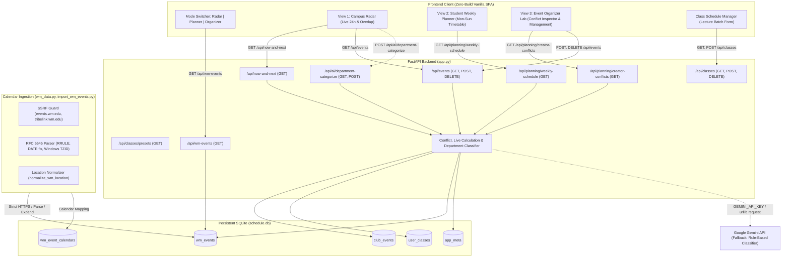
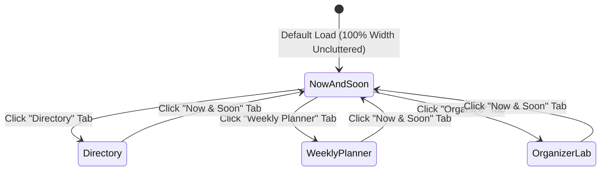

# &.events System Architecture

## 1. System Map & Component Boundaries

The `&.events` platform is an academic campus schedule and club event conflict engine designed following the AndEDU design system.



### Component Responsibilities & Data Ownership
| Component | Responsibility | Owned Data / State |
| :--- | :--- | :--- |
| **`app.py` (FastAPI Server)** | Boundary validation, schedule indexing, conflict calculations, department categorization, REST endpoints | `schedule.db` connection lifecycle, business rules, stdlib `.env` loader |
| **Department Classifier** | Deterministic keyword + AI semantic mapping to 7 core academic departments | Subject taxonomy definitions and department color tokens |
| **`wm_data.py`** | Safe RFC 5545 iCal parser, RRULE expansion, Windows TZID alias resolution, location normalization, SSRF host validation | Pure functions, parser and schema integrity |
| **`import_wm_events.py`** | Scheduled feed crawler & CLI importer for `events.wm.edu` and `tribelink.wm.edu` | Ingestion lifecycle, savepoint transactions |
| **`club_events` Table** | Authoritative store of weekly recurring club meetings | Campus events (title, club, category, day 0-6, start/end 24h, location, description) |
| **`user_classes` Table** | Authoritative store of student course commitments | User lecture sessions (course name, day 0-6, start/end 24h, location) |
| **`wm_events` Table** | Dated instances from official campus feeds and TribeLink student organizations | Dated event instances (uid, start_at, end_at, timezone, is_all_day, location, source_url, categories) |
| **`wm_event_calendars` Table** | Many-to-many calendar feed membership tracking | Feed slugs and calendar display names |
| **`app_meta` Table** | Database migrations and seed execution tracking | Migration version & seed flags |
| **`static/index.html`** | Zero-build single-page application with distraction-free 100% width Now & Soon view and collapsible Filters & Schedule modal | Local UI state: active view mode, filter modal open state, theme, preview time |

---

## 2. API Contracts & Boundary Schemas

All times are strict 24-hour zero-padded strings: `HH:MM` (`00:00` to `23:59`). Days are integers `0` to `6` (`0 = Monday`, `6 = Sunday`).

### 2.1 Event Management Contracts

#### `POST /api/events`
- **Status**: `201 Created`
- **Request Body (`EventCreate`)**:
```json
{
  "title": "Kernel & Dotfiles Workshop",
  "club_name": "Linux 1991 Club",
  "category": "Tech",
  "day_of_week": 0,
  "start_time": "17:00",
  "end_time": "18:30",
  "location": "ISC 1127",
  "description": "Customizing tiling window managers and shell configs."
}
```
- **Validation**:
  - `start_time < end_time` (raises `HTTP 400 Bad Request` if `start_time >= end_time`).
  - `day_of_week` in `0..6`.
  - Non-empty `title`, `club_name`, `category`, `location`.
- **Response**:
```json
{
  "id": 15,
  "title": "Kernel & Dotfiles Workshop",
  "club_name": "Linux 1991 Club",
  "category": "Tech",
  "day_of_week": 0,
  "start_time": "17:00",
  "end_time": "18:30",
  "location": "ISC 1127",
  "description": "Customizing tiling window managers and shell configs."
}
```

#### `DELETE /api/events/{event_id}`
- **Status**: `200 OK` (or `404 Not Found` if event does not exist)
- **Response**:
```json
{
  "status": "deleted",
  "id": 15
}
```

---

### 2.2 Planning & Conflict Contracts

#### `GET /api/planning/creator-conflicts`
Allows club organizers to test proposed event time windows against existing club events and student schedules.
- **Query Parameters**:
  - `day`: integer (`0..6`, required)
  - `start_time`: string (`HH:MM`, required)
  - `end_time`: string (`HH:MM`, required)
  - `location`: string (optional, checks for room collisions)
  - `exclude_event_id`: integer (optional, for event updates)
- **Validation**:
  - Raises `HTTP 400` if `start_time >= end_time`.
- **Response**:
```json
{
  "has_conflict": true,
  "slot": {
    "day": 0,
    "start_time": "14:00",
    "end_time": "15:30",
    "location": "McGlothlin-Street 020"
  },
  "summary": {
    "conflicting_events_count": 1,
    "conflicting_classes_count": 1,
    "has_location_clash": true
  },
  "conflicts": [
    {
      "type": "event",
      "id": 2,
      "name": "AI Paper Reading Group",
      "club_name": "AI Society",
      "location": "McGlothlin-Street 020",
      "day_of_week": 0,
      "start_time": "14:00",
      "end_time": "15:15",
      "severity": "location_clash"
    },
    {
      "type": "class",
      "id": 1,
      "name": "CSCI 241: Data Structures",
      "location": "Jones Hall 301",
      "day_of_week": 0,
      "start_time": "14:00",
      "end_time": "15:15",
      "severity": "class_conflict"
    }
  ]
}
```

#### `GET /api/planning/weekly-schedule`
Provides a single, consolidated source of truth for the 7-day academic week.
- **Query Parameters**: None (or optional `sim_day`, `sim_time` for demo parity)
- **Response**:
```json
{
  "days": [
    {
      "day": 0,
      "day_name": "Monday",
      "classes": [
        {
          "id": 1,
          "course_name": "CSCI 241: Data Structures",
          "day_of_week": 0,
          "start_time": "14:00",
          "end_time": "15:15",
          "location": "Jones Hall 301"
        }
      ],
      "events": [
        {
          "id": 2,
          "title": "AI Paper Reading Group",
          "club_name": "AI Society",
          "category": "Academic",
          "day_of_week": 0,
          "start_time": "14:00",
          "end_time": "15:15",
          "location": "McGlothlin-Street 020",
          "description": "Breaking down transformer attention optimizations.",
          "has_conflict": true,
          "conflicting_course": "CSCI 241: Data Structures"
        }
      ]
    }
  ],
  "stats": {
    "total_classes": 4,
    "total_events": 7,
    "conflicted_events": 2
  }
}
```

#### `GET /api/now-and-next`
Returns currently active sessions, upcoming events within 3 hours across club and official W&M feeds, and the student's prioritized academic schedule for the day.
- **Query Parameters**:
  - `sim_day`: integer (`0..6`, optional)
  - `sim_time`: string (`HH:MM`, optional)
  - `tags`: string (comma-separated student interest tags, e.g. `CS,DATA`, optional)
- **Response**:
```json
{
  "current_day": 0,
  "current_day_name": "Monday",
  "current_time": "14:15",
  "is_simulated": false,
  "academic_summary": {
    "total_today": 2,
    "completed_count": 0,
    "has_current": true,
    "has_upcoming": true
  },
  "current_class": {
    "id": 1,
    "course_name": "CSCI 241: Data Structures",
    "day_of_week": 0,
    "start_time": "14:00",
    "end_time": "15:15",
    "start_time_12h": "2:00 PM",
    "end_time_12h": "3:15 PM",
    "location": "Jones Hall 301",
    "status": "current",
    "minutes_remaining": 60,
    "status_label": "In Session · 60m left"
  },
  "active_class": {
    "id": 1,
    "course_name": "CSCI 241: Data Structures",
    "day_of_week": 0,
    "start_time": "14:00",
    "end_time": "15:15",
    "start_time_12h": "2:00 PM",
    "end_time_12h": "3:15 PM",
    "location": "Jones Hall 301",
    "status": "current",
    "minutes_remaining": 60,
    "status_label": "In Session · 60m left"
  },
  "next_class": {
    "id": 2,
    "course_name": "MATH 211: Linear Algebra",
    "day_of_week": 0,
    "start_time": "15:30",
    "end_time": "16:45",
    "start_time_12h": "3:30 PM",
    "end_time_12h": "4:45 PM",
    "location": "Jones Hall 202",
    "status": "upcoming",
    "minutes_until_start": 75,
    "status_label": "Starts in 1h 15m"
  },
  "today_classes": [
    {
      "id": 1,
      "course_name": "CSCI 241: Data Structures",
      "day_of_week": 0,
      "start_time": "14:00",
      "end_time": "15:15",
      "start_time_12h": "2:00 PM",
      "end_time_12h": "3:15 PM",
      "location": "Jones Hall 301",
      "status": "current",
      "minutes_remaining": 60,
      "status_label": "In Session · 60m left"
    },
    {
      "id": 2,
      "course_name": "MATH 211: Linear Algebra",
      "day_of_week": 0,
      "start_time": "15:30",
      "end_time": "16:45",
      "start_time_12h": "3:30 PM",
      "end_time_12h": "4:45 PM",
      "location": "Jones Hall 202",
      "status": "upcoming",
      "minutes_until_start": 75,
      "status_label": "Starts in 1h 15m"
    }
  ],
  "happening_now": [
    {
      "id": 1,
      "title": "Kernel & Dotfiles Workshop",
      "club_name": "Linux 1991 Club",
      "category": "Tech",
      "day_of_week": 0,
      "start_time": "17:00",
      "end_time": "18:30",
      "location": "ISC 1127",
      "description": "Customizing tiling window managers and shell configs.",
      "has_conflict": false,
      "conflicting_course": null,
      "minutes_remaining": 75,
      "status_label": "In Session · 75m left",
      "is_all_day": false,
      "is_ongoing": false
    }
  ],
  "starting_soon": [],
  "upcoming_today": []
}
```

#### `GET /api/classes/presets`
Returns static, curated William & Mary course presets across departments (CSCI, DATA, MATH, PHIL, BIOL, CHEM) and standard academic meeting time blocks (MWF 50m, TR 75m) for fast 1-click schedule enrollment.
- **Query Parameters**: None
- **Response**:
```json
{
  "courses": [
    {
      "course_name": "CSCI 241: Data Structures",
      "department": "CSCI",
      "days": [0, 2],
      "days_label": "MW",
      "start_time": "14:00",
      "end_time": "15:15",
      "location": "Jones Hall 301",
      "time_range_12h": "2:00 PM – 3:15 PM"
    }
  ],
  "slots": [
    {
      "name": "MWF 50m",
      "days": [0, 2, 4],
      "days_label": "MWF",
      "slots": [
        {"start_time": "10:00", "end_time": "10:50", "label": "10:00–10:50"}
      ]
    }
  ]
}
```

---

### 2.3 Academic Department Taxonomy & AI Categorizer Contracts

Every campus event (club meetings, dated W&M events, Muscarelle exhibitions, athletics matches, guest lectures) is enriched with an academic department classification.

#### Official 7-Department Taxonomy
| Department ID (`department_id`) | Department Name (`department_name`) | Subject Color (`department_color`) | Visual Token | Scope & Disciplines |
| :--- | :--- | :--- | :--- | :--- |
| `dept-cs` | Computer Science & Technology | `#2c6eb5` | Technical Blue | CS, CSCI, Software, Coding, Linux, AI, Hackathons, Robotics, Systems, Cyber |
| `dept-arts` | Arts & Museum Exhibitions | `#8b3ab8` | Creative Violet/Plum | Fine Arts, Muscarelle Museum, Theater, Music, Orchestra, Choir, Dance, Exhibitions |
| `dept-sports` | Athletics & Recreation | `#b07d1e` | Amber/Olive | Tribe Athletics, Kaplan Arena, Intramural Sports, Rec Center, Tennis, Soccer, Swim |
| `dept-biol` | Marine Science & Biology | `#19787a` | Sage/Teal | Biology, VIMS Marine Science, Botany, Ecology, Pre-Med, Chemistry, Genetics |
| `dept-civics` | Civics, History & Dialogue | `#8c532b` | Classical Bronze | History, Government, Law, Public Policy, Philosophy, Ethics, Debates, Global Affairs |
| `dept-life` | Student Life & RSO Clubs | `#c9a24a` | Warm Gold | Campus Life, Social RSOs, Wellness, Mindfulness, Traditions, Community Hangouts |
| `dept-acad` | Academic & Professional | `#4a5b66` | Classic Slate | Career Center, Workshops, Professional Development, Symposia, Admissions |

#### Enriched Event Contract Boundary
All endpoints returning events (`/api/events`, `/api/now-and-next`, `/api/wm-events`, `/api/planning/weekly-schedule`, and `POST /api/events`) guarantee the inclusion of:
```json
{
  "department_id": "dept-cs",
  "department_name": "Computer Science & Technology",
  "department_color": "#2c6eb5"
}
```

#### `POST /api/ai/department-categorize` (and `GET /api/ai/department-categorize`)
Classifies events using Google Gemini when `GEMINI_API_KEY` is present; seamlessly falls back to deterministic rule-based taxonomy classification when the key is omitted, blank, or network is unavailable.
- **Request Body (Optional)**:
```json
{
  "events": [
    {
      "id": 1,
      "title": "Kernel & Dotfiles Workshop",
      "club_name": "Linux 1991 Club",
      "category": "Tech",
      "location": "ISC 1127",
      "description": "Customizing tiling window managers and shell configs."
    }
  ]
}
```
- **Response**:
```json
{
  "source": "gemini",
  "count": 1,
  "events": [
    {
      "id": 1,
      "title": "Kernel & Dotfiles Workshop",
      "department_id": "dept-cs",
      "department_name": "Computer Science & Technology",
      "department_color": "#2c6eb5",
      "ai_summary": "Hands-on systems workshop exploring shell automation and window manager configuration."
    }
  ]
}
```
*(When `GEMINI_API_KEY` is absent, `"source": "deterministic"` is returned with the exact same schema).*

---

## 3. Database Schema & Indexing

```sql
CREATE TABLE IF NOT EXISTS club_events (
    id INTEGER PRIMARY KEY AUTOINCREMENT,
    title TEXT NOT NULL,
    club_name TEXT NOT NULL,
    category TEXT NOT NULL,
    day_of_week INTEGER NOT NULL,
    start_time TEXT NOT NULL,
    end_time TEXT NOT NULL,
    location TEXT NOT NULL,
    description TEXT
);

CREATE TABLE IF NOT EXISTS user_classes (
    id INTEGER PRIMARY KEY AUTOINCREMENT,
    course_name TEXT NOT NULL,
    day_of_week INTEGER NOT NULL,
    start_time TEXT NOT NULL,
    end_time TEXT NOT NULL,
    location TEXT
);

CREATE TABLE IF NOT EXISTS wm_events (
    uid TEXT PRIMARY KEY,
    title TEXT NOT NULL,
    summary TEXT NOT NULL DEFAULT '',
    description TEXT NOT NULL DEFAULT '',
    start_at TEXT NOT NULL,
    end_at TEXT,
    timezone TEXT NOT NULL,
    location TEXT NOT NULL DEFAULT '',
    source_url TEXT NOT NULL DEFAULT '',
    categories TEXT NOT NULL DEFAULT '[]',
    is_all_day INTEGER NOT NULL DEFAULT 0 CHECK (is_all_day IN (0, 1))
);

CREATE TABLE IF NOT EXISTS wm_event_calendars (
    uid TEXT NOT NULL REFERENCES wm_events(uid) ON DELETE CASCADE,
    calendar_slug TEXT NOT NULL,
    calendar_name TEXT NOT NULL,
    PRIMARY KEY (uid, calendar_slug)
);

CREATE TABLE IF NOT EXISTS app_meta (
    key TEXT PRIMARY KEY,
    value TEXT
);

-- Compound indexes for zero-latency temporal lookups
CREATE INDEX IF NOT EXISTS idx_club_events_day_time ON club_events (day_of_week, start_time);
CREATE INDEX IF NOT EXISTS idx_user_classes_day_time ON user_classes (day_of_week, start_time);
CREATE INDEX IF NOT EXISTS idx_wm_events_start_at ON wm_events(start_at);
CREATE INDEX IF NOT EXISTS idx_wm_event_calendars_slug ON wm_event_calendars(calendar_slug, uid);
```

### Overlap Rule
Two periods $(S_1, E_1)$ and $(S_2, E_2)$ on day $D_1 = D_2$ overlap if and only if:
$$S_1 < E_2 \quad \text{AND} \quad E_1 > S_2$$

---

## 4. Frontend Architecture & Design System

The frontend is implemented strictly as a zero-build single page application in `static/index.html`.

### 4.1 Mode State Machine & Distraction-Free Layout


1. **Now & Soon (`live`)**:
   - 100% width, uncluttered campus pulse.
   - Shows "Happening Right Now" (including active all-day and ongoing multi-day campus & TribeLink events) and "Starting in the next 3 hours".
   - The permanent left-hand planning sidebar is completely collapsed into a neat "Filters" modal/drawer button.
2. **Filters & Schedule Modal (`#filtersModal`)**:
   - Accessible via the "Filters" button in the masthead/header.
   - Houses event search, quick day pills (`All`, `Mon`..`Sun`), category filter, conflict toggle, and student course manager.
   - Closes cleanly via Escape, backdrop click, or Close button so planning controls never compromise the live view.
3. **Directory Mode (`directory`)**:
   - Comprehensive searchable view combining imported W&M dated feeds and student club schedules.
4. **Student Weekly Planner (`planner`)**:
   - Mon–Sun 7-day grid view comparing academic classes and club events with overlap badges.
5. **Event Organizer Lab (`organizer`)**:
   - Propose event time and location; checks for class overlap and room collisions using canonicalized building names.

### 4.2 AndEDU Design System Tokens & Chrome Stability
- **Masthead & Frame Consistency**:
  - The masthead retains its crisp Technical Blue styling (`#0d1e38` background, Caslon gold border, and `#ffffff` high-contrast reading) as the stable anchor of the application.
  - The masthead does not darken or swing across disparate colors when browsing different events. The chrome remains stable, letting the events themselves supply subject-matter color.
- **Palette Tokens**:
  - Stable Masthead Navy: `--masthead-bg: #0d1e38`, `--brand-line: rgba(59, 130, 246, 0.4)`
  - Stone Paper / Surface: `--paper: #f1f0ea` / `#050806`, `--surface: #ffffff` / `#0e1411`
  - Caslon Gold Accents: `--gold: #c9a24a` / `#e0bb62`, `--gold-text: #6f5114` / `#e8c877`
  - Interactive Accent: `--accent: #2c6eb5` / `#5aae8b`
  - Available Status: `--ok: #0e4a37` / `#5fb390`
  - Conflict Status: `--bad: #9a2b2b` / `#e27f72`

### 4.3 Department-Themed Event Cards
Rather than changing the entire page chrome, every individual event card across the app (club meetings, W&M calendar events, Muscarelle exhibitions, athletics games, symposiums) carries its department's visual identity:
1. **Left Border Accent**:
   - `dept-cs`: `4px solid #2c6eb5` (Technical Blue)
   - `dept-arts`: `4px solid #8b3ab8` (Creative Violet/Plum)
   - `dept-sports`: `4px solid #b07d1e` (Amber/Olive)
   - `dept-biol`: `4px solid #19787a` (Sage/Teal)
   - `dept-civics`: `4px solid #8c532b` (Classical Bronze)
   - `dept-life`: `4px solid #c9a24a` (Warm Gold)
   - `dept-acad`: `4px solid #4a5b66` (Classic Slate)
2. **Department Badge Pill**:
   - Compact inline pill styled with the department's tint and text color (e.g. `<span class="dept-badge dept-cs">Computer Science & Technology</span>`).
   - Sits alongside status indicators (`In Session`, `Starts soon`) without visual interference.

### 4.4 View Arrangement Controls
In event browsing modes (`Now & Soon` and `Directory`), users can arrange event cards with three toggles:
- **`[ Chronological ]`** (Default): Events ordered by start time, ending soonest, or scheduled timetable order.
- **`[ 🏢 Group by Department ]`**: Events organized into visual departmental clusters with header banners and counts.
- **`[ 🔀 Shuffle by Department ]`**: Round-robin interleave across departments, guaranteeing that students encounter an eclectic, interdisciplinary mix of events (CS, Arts, Athletics, Biology, Civics, Life) rather than a monolithic block of one type.

---

## 5. Reliability, Performance & Security

1. **SSRF Guard & Network Perimeter**:
   - Host allowlist strictly restricted to `{"events.wm.edu", "tribelink.wm.edu"}`.
   - Enforces HTTPS scheme, port 443 (or default HTTPS port), and forbids embedded user/password credentials.
   - Protects crawler and feed imports against private subnet probing and redirect hijacking.
2. **Deterministic RFC 5545 iCalendar Parsing**:
   - Recurrence Expansion (`RRULE:FREQ=DAILY|WEEKLY`, `INTERVAL`, `BYDAY`, `UNTIL`, `COUNT`, `EXDATE`) over `[now - 2 days, now + 45 days]`.
   - Generates deterministic instance UIDs: `{master_uid}::{occ_start}`.
   - Canonicalizes Windows/Exchange time zones (`"Eastern Standard Time"`, `"EST"`, `"US/Eastern"`) to `"America/New_York"`.
   - Resolves `VALUE=DATE` all-day bounds: missing or non-positive `DTEND` defaults to `DTSTART + 1 day`.
3. **Location Normalization & Conflict Accuracy**:
   - `normalize_wm_location()` canonicalizes building variants (e.g. `"Integrated Science Center"`, `"ISC"`, `"Sadler Center"`, `"Jones Hall"`) and strips extraneous `"Room"` / `"Rm."` noise.
   - Guarantees room collision detection (`ROOM_CLASH`) regardless of minor differences in address spelling.
4. **Performance & Concurrency**:
   - Compound indexes `(day_of_week, start_time)` and `(start_at)` eliminate table scans.
   - SQLite WAL mode and foreign key integrity.
   - Zero-build vanilla JS ensures instant page load (<50ms) with zero bundle bloat.
5. **Security**:
   - Parameterized SQL queries (`?` placeholders) prevent SQL injection across all endpoints.
   - HTML sanitization (`escapeHtml`) on the client prevents Cross-Site Scripting (XSS).
   - Strict 127.0.0.1 default binding for development.
6. **Safe Environment & AI Integration**:
   - Standard library `.env` loader on application startup reads key-value pairs without third-party dependencies (`python-dotenv`).
   - `GEMINI_API_KEY` is loaded strictly from environment or `.env` and never written to logs or transmitted to clients.
   - Outbound requests to Gemini API use standard library `urllib.request` with strict timeouts and seamless fallback to deterministic department classification.
