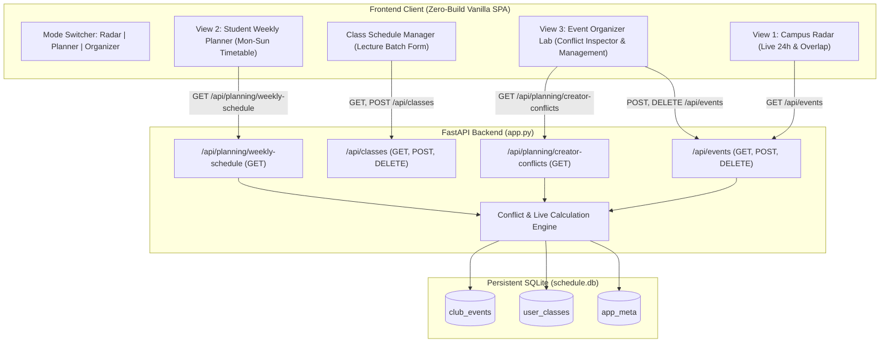
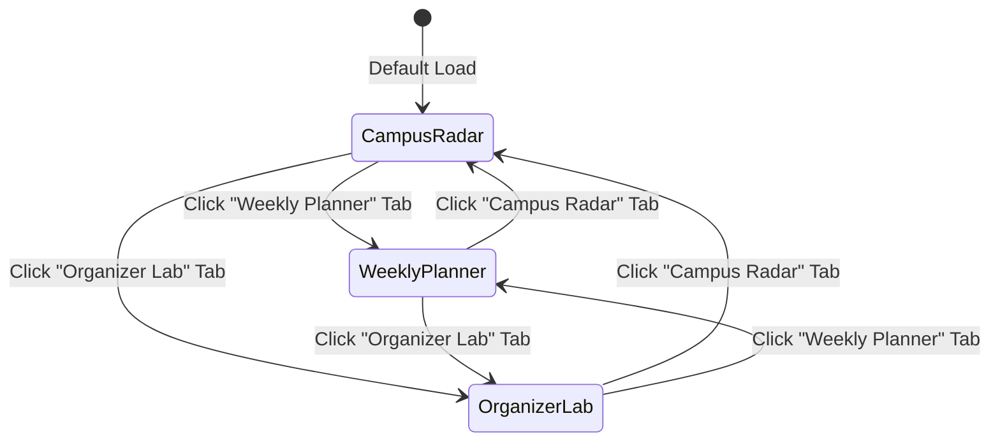

# &.events System Architecture

## 1. System Map & Component Boundaries

The `&.events` platform is an academic campus schedule and club event conflict engine designed following the AndEDU design system.



### Component Responsibilities & Data Ownership
| Component | Responsibility | Owned Data / State |
| :--- | :--- | :--- |
| **`app.py` (FastAPI Server)** | Boundary validation, schedule indexing, conflict calculations, REST endpoints | `schedule.db` connection lifecycle, business rules |
| **`club_events` Table** | Authoritative store of campus club meetings, workshops, and sports | Campus events (title, club, category, day 0-6, start/end 24h, location, description) |
| **`user_classes` Table** | Authoritative store of student course commitments | User lecture sessions (course name, day 0-6, start/end 24h, location) |
| **`app_meta` Table** | Database migrations and seed execution tracking | Migration version & seed flags |
| **`static/index.html`** | Zero-build single-page application with 3 distinct operational modes adhering to AndEDU design tokens | Local UI state: active mode tab, theme preference, hackathon demo simulation time |

---

## 2. API Contracts & Boundary Schemas

All times are strict 24-hour zero-padded strings: `HH:MM` (`00:00` to `23:59`). Days are integers `0` to `6` (`0 = Monday`, `6 = Sunday`).

### 2.1 Event Management Contracts

#### `POST /api/events`
- **Status**: `201 Created`
- **Request Body (`EventCreate`)**:
```json
{
  "title": "Kernel & Dotfiles Workshop",
  "club_name": "Linux 1991 Club",
  "category": "Tech",
  "day_of_week": 0,
  "start_time": "17:00",
  "end_time": "18:30",
  "location": "ISC 1127",
  "description": "Customizing tiling window managers and shell configs."
}
```
- **Validation**:
  - `start_time < end_time` (raises `HTTP 400 Bad Request` if `start_time >= end_time`).
  - `day_of_week` in `0..6`.
  - Non-empty `title`, `club_name`, `category`, `location`.
- **Response**:
```json
{
  "id": 15,
  "title": "Kernel & Dotfiles Workshop",
  "club_name": "Linux 1991 Club",
  "category": "Tech",
  "day_of_week": 0,
  "start_time": "17:00",
  "end_time": "18:30",
  "location": "ISC 1127",
  "description": "Customizing tiling window managers and shell configs."
}
```

#### `DELETE /api/events/{event_id}`
- **Status**: `200 OK` (or `404 Not Found` if event does not exist)
- **Response**:
```json
{
  "status": "deleted",
  "id": 15
}
```

---

### 2.2 Planning & Conflict Contracts

#### `GET /api/planning/creator-conflicts`
Allows club organizers to test proposed event time windows against existing club events and student schedules.
- **Query Parameters**:
  - `day`: integer (`0..6`, required)
  - `start_time`: string (`HH:MM`, required)
  - `end_time`: string (`HH:MM`, required)
  - `location`: string (optional, checks for room collisions)
  - `exclude_event_id`: integer (optional, for event updates)
- **Validation**:
  - Raises `HTTP 400` if `start_time >= end_time`.
- **Response**:
```json
{
  "has_conflict": true,
  "slot": {
    "day": 0,
    "start_time": "14:00",
    "end_time": "15:30",
    "location": "McGlothlin-Street 020"
  },
  "summary": {
    "conflicting_events_count": 1,
    "conflicting_classes_count": 1,
    "has_location_clash": true
  },
  "conflicts": [
    {
      "type": "event",
      "id": 2,
      "name": "AI Paper Reading Group",
      "club_name": "AI Society",
      "location": "McGlothlin-Street 020",
      "day_of_week": 0,
      "start_time": "14:00",
      "end_time": "15:15",
      "severity": "location_clash"
    },
    {
      "type": "class",
      "id": 1,
      "name": "CSCI 241: Data Structures",
      "location": "Jones Hall 301",
      "day_of_week": 0,
      "start_time": "14:00",
      "end_time": "15:15",
      "severity": "class_conflict"
    }
  ]
}
```

#### `GET /api/planning/weekly-schedule`
Provides a single, consolidated source of truth for the 7-day academic week.
- **Query Parameters**: None (or optional `sim_day`, `sim_time` for demo parity)
- **Response**:
```json
{
  "days": [
    {
      "day": 0,
      "day_name": "Monday",
      "classes": [
        {
          "id": 1,
          "course_name": "CSCI 241: Data Structures",
          "day_of_week": 0,
          "start_time": "14:00",
          "end_time": "15:15",
          "location": "Jones Hall 301"
        }
      ],
      "events": [
        {
          "id": 2,
          "title": "AI Paper Reading Group",
          "club_name": "AI Society",
          "category": "Academic",
          "day_of_week": 0,
          "start_time": "14:00",
          "end_time": "15:15",
          "location": "McGlothlin-Street 020",
          "description": "Breaking down transformer attention optimizations.",
          "has_conflict": true,
          "conflicting_course": "CSCI 241: Data Structures"
        }
      ]
    }
  ],
  "stats": {
    "total_classes": 4,
    "total_events": 7,
    "conflicted_events": 2
  }
}
```

---

## 3. Database Schema & Indexing

```sql
CREATE TABLE IF NOT EXISTS club_events (
    id INTEGER PRIMARY KEY AUTOINCREMENT,
    title TEXT NOT NULL,
    club_name TEXT NOT NULL,
    category TEXT NOT NULL,
    day_of_week INTEGER NOT NULL,
    start_time TEXT NOT NULL,
    end_time TEXT NOT NULL,
    location TEXT NOT NULL,
    description TEXT
);

CREATE TABLE IF NOT EXISTS user_classes (
    id INTEGER PRIMARY KEY AUTOINCREMENT,
    course_name TEXT NOT NULL,
    day_of_week INTEGER NOT NULL,
    start_time TEXT NOT NULL,
    end_time TEXT NOT NULL,
    location TEXT
);

CREATE TABLE IF NOT EXISTS app_meta (
    key TEXT PRIMARY KEY,
    value TEXT
);

-- Compound indexes for zero-latency temporal lookups
CREATE INDEX IF NOT EXISTS idx_club_events_day_time ON club_events (day_of_week, start_time);
CREATE INDEX IF NOT EXISTS idx_user_classes_day_time ON user_classes (day_of_week, start_time);
```

### Overlap Rule
Two periods $(S_1, E_1)$ and $(S_2, E_2)$ on day $D_1 = D_2$ overlap if and only if:
$$S_1 < E_2 \quad \text{AND} \quad E_1 > S_2$$

---

## 4. Frontend Architecture & Design System

The frontend is implemented strictly as a zero-build single page application in `static/index.html`.

### 4.1 3-Mode State Machine


1. **Campus Radar (`radar`)**:
   - Live 24-hour clock with active scanning pulse.
   - Engineering lab readout banner ("Attend Right Now / Starting in 60m").
   - Multi-parameter filter bar (Search, Day, Category, Can Attend Now, Hide Conflicts).
   - Real-time club events stream.
2. **Student Weekly Planner (`planner`)**:
   - Mon–Sun 7-day grid view.
   - Simultaneous display of academic classes and club events.
   - Gentle non-creator conflict badges (highlighting when an event conflicts with a course).
   - Weekly load statistics (total classes, attended events, conflicts).
3. **Event Organizer Lab (`organizer`)**:
   - Slot conflict inspector: inputs Day, Start Time, End Time, Location.
   - Real-time collision tester against existing events (room booking clash vs attendance competition) and student classes.
   - Event creation form with `POST /api/events`.
   - Event deletion and catalog management.

### 4.2 AndEDU Design System Tokens
- **Palette**:
  - Griffin Green Frame: `--side-bg: #0b3b2c` (Light) / `#07140f` (Dark)
  - Stone Paper / Surface: `--paper: #f1f0ea` / `#050806`, `--surface: #ffffff` / `#0e1411`
  - Caslon Gold Accents: `--gold: #c9a24a` / `#e0bb62`, `--gold-text: #6f5114` / `#e8c877`
  - Interactive Accent: `--accent: #0e4a37` / `#5aae8b`
  - Available Status: `--ok: #0e4a37` / `#5fb390`
  - Conflict Status: `--bad: #9a2b2b` / `#e27f72`
- **Typography**:
  - Headings: `Libre Caslon Text`, Georgia, serif
  - Code, Badges, 24h Times: `IBM Plex Mono`, monospace (tabular-nums)
  - Body: `IBM Plex Sans`, -apple-system, sans-serif
- **Geometry**:
  - Corners: `--radius-sm: 3px`, `--radius-md: 6px`
  - Engineering grid background: `24px 24px`

---

## 5. Reliability, Performance & Security
1. **Performance**:
   - Compound indexes `(day_of_week, start_time)` eliminate table scans.
   - In-memory time conversions in Python prevent DB-level string parsing overhead.
   - Zero-build vanilla JS ensures instant page load (<50ms) with zero bundle bloat.
2. **Reliability & Idempotency**:
   - Strict input validation with Pydantic ensures malformed 24h time strings never reach the database.
   - Atomic SQLite transactions (`conn.commit()`) ensure integrity across batch operations.
3. **Security**:
   - Parameterized SQL queries (`?` placeholders) prevent SQL injection across all endpoints.
   - HTML sanitization (`escapeHtml`) on the client prevents Cross-Site Scripting (XSS).
   - Strict 127.0.0.1 default binding for development.
