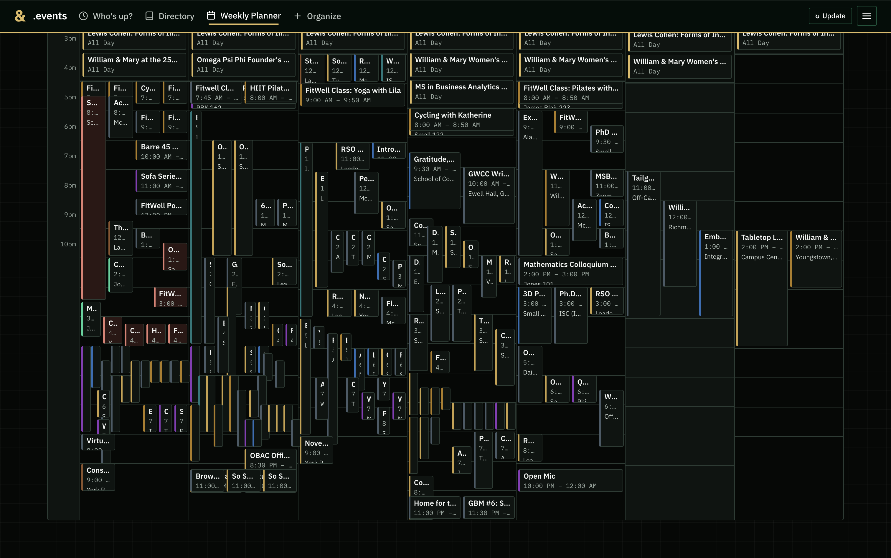
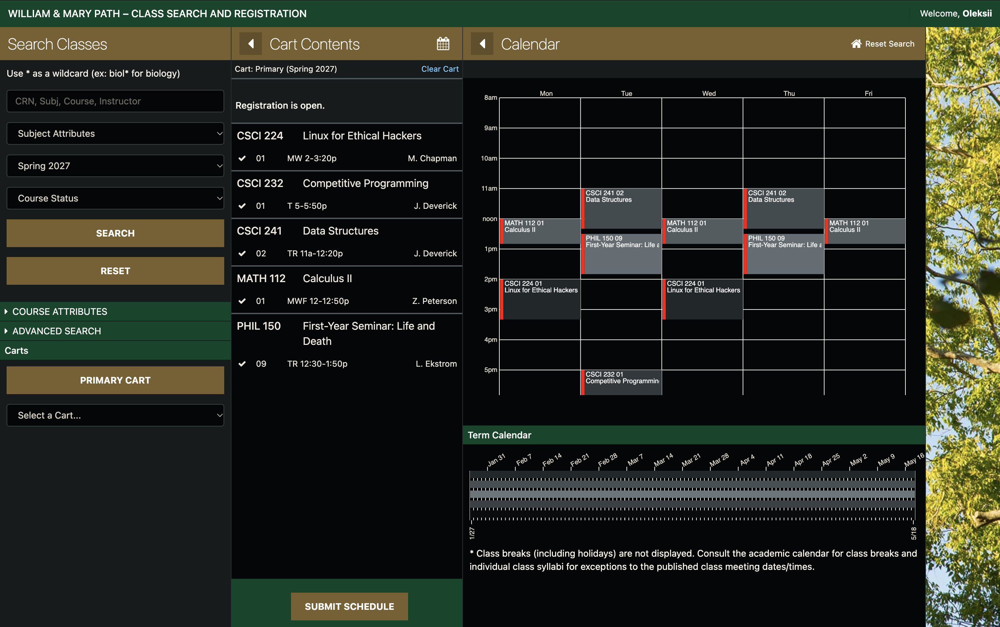
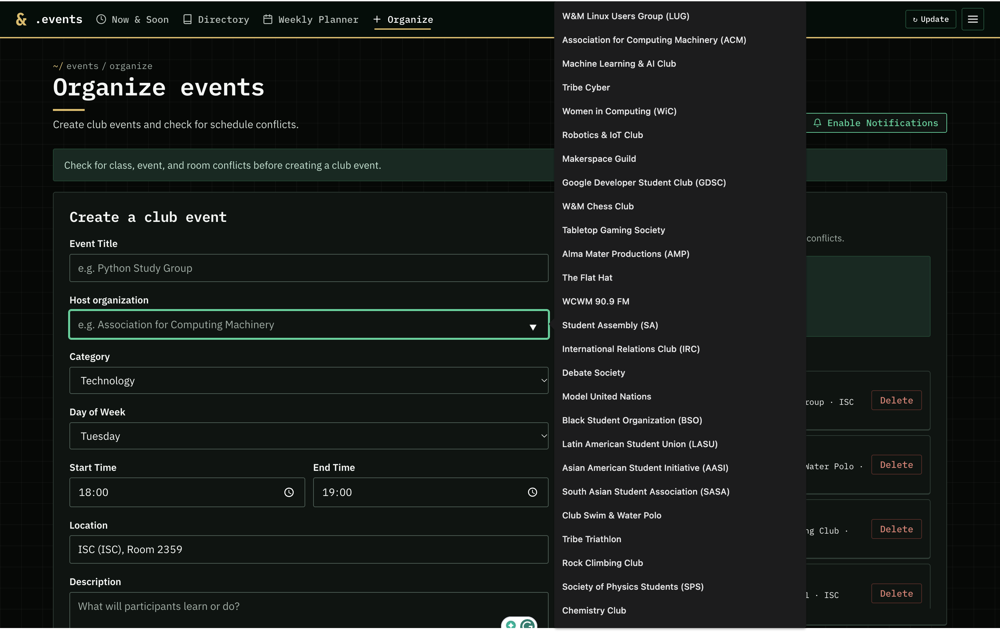
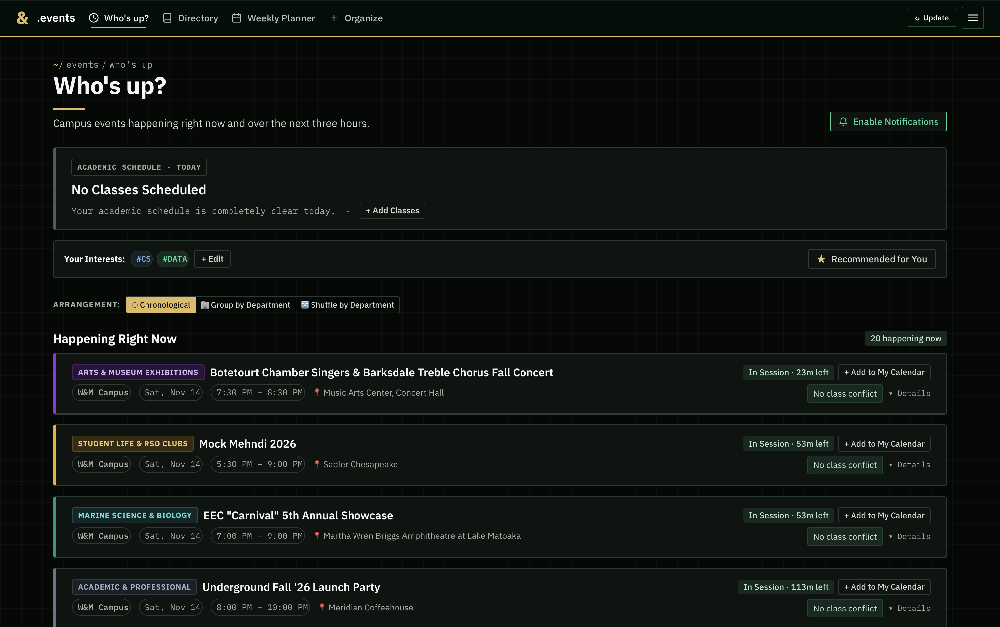

<div align="center">
  
  <h1>&amp;.events</h1>
  <p><strong>Campus Intelligence &amp; Academic Schedule Engine for William &amp; Mary</strong></p>
  <p>Live Campus Pulse · 7-Day Timetable Grid · W&amp;M Feed Synchronization · Conflict Detection</p>

  <p>
    <a href="#key-features">Features</a> •
    <a href="#visual-tour">Visual Tour</a> •
    <a href="#quick-start">Quick Start</a> •
    <a href="#system-architecture">Architecture</a> •
    <a href="#calendar-export--system-sync">Calendar Export</a> •
    <a href="claude.md">Master Plan (Claude)</a>
  </p>
</div>

---

## Overview

**`&.events`** is a high-performance campus intelligence engine and student timetable planner designed specifically for the **College of William & Mary**. It bridges the gap between academic commitments (classes, labs, lectures) and live campus life (student organizations/RSOs, department talks, art exhibitions, athletic events, and public campus calendars).

The project is built to seamlessly merge into **[&.edu](https://github.com/alexbespik/AndEDU)**, delivering zero-friction academic planning alongside guided study tracks.

---

## Visual Tour

| 7-Day Weekly Timetable Grid | W&M Path Visual Reference |
| :---: | :---: |
|  |  |
| *Synchronized 7am–10pm grid, collision grouping, and collapsible all-day lane.* | *Authentic William & Mary Path design language benchmark.* |

| Who's Up? Live Campus Pulse | Floating Nav & Arrangement Tabs |
| :---: | :---: |
|  |  |
| *Happening Now & Starting Soon feeds with in-session countdowns.* | *Floating subnav with pure Cypher Gold underline and zero background grayness.* |

---

## Key Features

### 1. 7-Day Interactive Weekly Planner
- **W&M Path Design Language**: 7:00 AM to 10:00 PM horizontal hourly canvas with synchronized baseline gutters.
- **Collapsible All-Day Strip**: Consolidated 36px fixed-height all-day row (`📅 N All-Day Events ▾`) that expands into full event listings without shifting the timed grid downwards.
- **Expandable Time Slot Clusters**: When multiple events coincide at the same hour, they are rendered with primary event priority plus an overflow card (`+N more events · Click to expand`). Clicking expands an interactive modal dialog listing each concurrent event.
- **Dual-Scope Planning**:
  - **★ My Calendar**: Student's enrolled courses + starred/created campus events (clean, spacious, conflict-free).
  - **🏫 All Campus Events**: Complete 500+ event campus directory with interactive departmental filtering (`All`, `CS & Tech`, `Arts`, `Athletics`, `Biology`, `Civics`, `Student Life`).

### 2. Native System Calendar Export (`.ics`)
- **Direct 1-Click Import**: Export individual events, enrolled class sessions, or entire weekly schedules directly to macOS Calendar.app, Apple Calendar (iOS), and Microsoft Outlook via RFC 5545 `.ics` downloads.
- **Google Calendar Deep-Links**: One-click web template links for instant addition to Google Calendar.
- **Standardized iCalendar API**: `GET /api/calendar/export.ics` with strict CRLF line endings, text escaping, and `TZID=America/New_York` recurrence rules.

### 3. Automated 24-Hour Campus Sync
- **FastAPI Lifespan Background Task**: Periodically verifies `app_meta` sync timestamps and automatically pulls latest events from 15 William & Mary public feeds once every 24 hours.
- **Status & Control Endpoints**:
  - `GET /api/parser/status`: Reports sync health, total active events, and `next_auto_sync` ISO timestamp.
  - `POST /api/parser/run`: Manual crawler trigger protected by concurrency locks (`_PARSER_LOCK`).

### 4. Proactive Campus Event Notifications
- **Targeted Non-Lesson Alerts**: Evaluates events starting within 30 minutes, strictly excluding academic classes to eliminate notification fatigue.
- **Dual Presentation**: Delivers desktop OS-level alerts via the Web Notification API alongside non-intrusive in-app banner toasts (`showToast`).
- **Session Deduplication**: Guarantees each event triggers at most once per browsing session using `sessionStorage`.

### 5. Conflict & Room Clash Engine
- **Academic Priority**: Real-time room clash (`ROOM_CLASH`) and class collision (`CLASS_OVERLAP`) detection prevents students from scheduling conflicting extracurriculars.
- **Location Normalization**: `normalize_wm_location()` canonicalizes building variants (e.g. `ISC 1127`, `Integrated Science Center`, `Sadler Center`, `Jones Hall 301`) for exact spatial awareness.

### 6. Design System & Typography
- **Zero AI Slop / Anti-Slop**: Built to match `&.edu` aesthetic guidelines:
  - **Headings & UI**: Pure **`IBM Plex Sans`** (`font-weight: 700 / 600; letter-spacing: -0.02em;`). Monospace and serif fonts are strictly prohibited on titles.
  - **Monospace Reserved**: `IBM Plex Mono` is strictly reserved for timestamps (`14:00`), course codes (`CSCI 241`), and room numbers.
  - **Floating Navigation**: Zero background grayness (`background: transparent !important`) with 2px Cypher Gold indicator lines (`::after { background: var(--gold); }`).

---

## Quick Start

### Prerequisites
- Python 3.11+
- Git

### Installation & Execution

```bash
# 1. Clone repository
git clone https://github.com/alexbespik/AndEVENTS.git
cd AndEVENTS

# 2. Create virtual environment
python3 -m venv .venv
source .venv/bin/activate

# 3. Install dependencies
pip install -r requirements.txt

# 4. Start local development server
python3 -m uvicorn app:app --reload --port 8000
```

Open your browser to [http://127.0.0.1:8000](http://127.0.0.1:8000).

---

## Automated Test Suite

Run the full empirical test suite (30 tests across API, data normalization, and calendar ingestion):

```bash
python3 -m unittest discover tests && python3 -m unittest test_wm_data.py && python3 -m unittest test_import_wm_events.py
```

---

## Calendar Ingestion

Sync public William & Mary event feeds manually:

```bash
# Auto-discover and parse all active campus calendars
python3 import_wm_events.py --discover

# Parse local iCalendar payload directly
python3 import_wm_events.py --file campus=events.ics
```

Supported feeds include:
- `wm-main` (University-wide calendar)
- `tribelink` (Student organization & RSO events)
- `computerscience` (Computer Science & Technology)
- `arts`, `theatre-performance`, `music` (Arts & Culture)
- `athletics`, `recsports` (Athletics & Recreation)
- `libraries` (Swem Library)
- `career` (Cohen Career Center)
- `wellness`, `student-affairs`, `cce`, `academiccalendarug`

---

## System Architecture

```
AndEVENTS/
├── app.py                 # FastAPI application, lifespan background scheduler, iCal export
├── wm_data.py             # SQLite schemas, building normalization, seed fixtures
├── import_wm_events.py    # Multi-feed iCalendar parser & network crawler
├── static/
│   ├── index.html         # Single-page UI, 7-day planner grid, modals, live timers
│   ├── lab.css            # Style system, floating nav, dark/light themes, grid layouts
│   └── favicon.svg        # Cypher Gold ampersand branding icon
├── docs/
│   └── screenshots/       # Visual references, UI progressions, and design benchmarks
├── claude.md              # Master engineering & refactoring specification for Claude
├── ARCHITECTURE.md        # Deep architectural contracts, data models, and API specs
└── tests/
    └── test_api.py        # Automated endpoint and integration verification tests
```

---

## License & Attribution

Part of the **[&.edu](https://github.com/alexbespik/AndEDU)** open educational software ecosystem for the College of William & Mary.
Developed by [Oleksii Bespalko](https://github.com/alexbespik).
