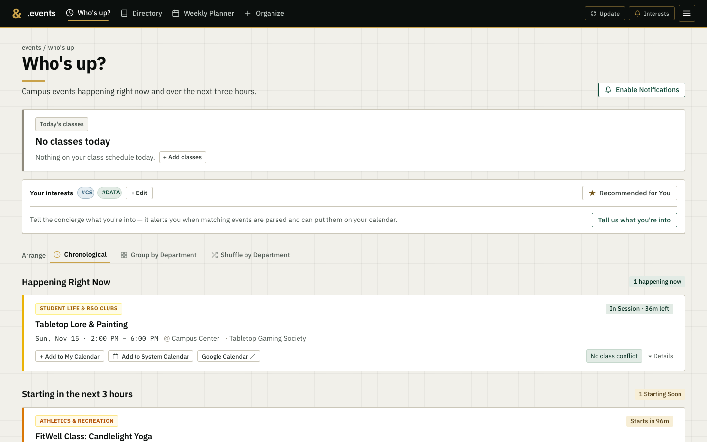
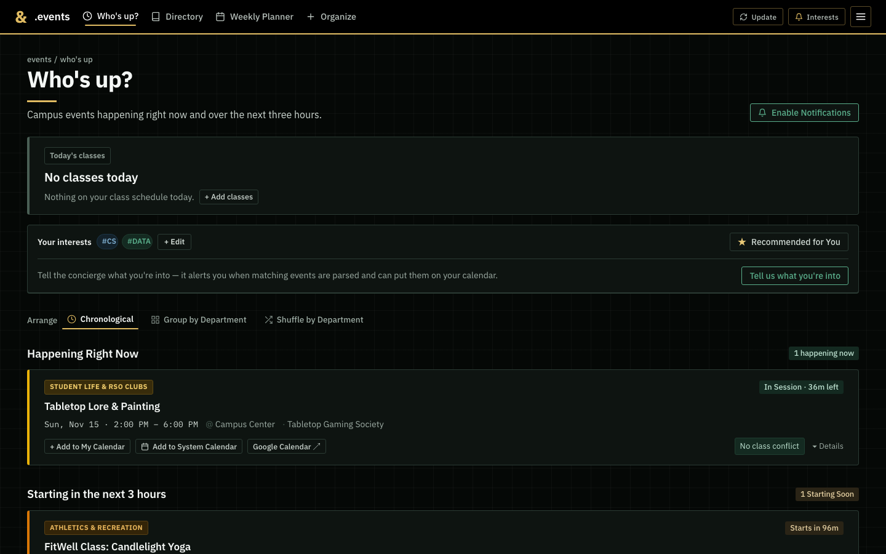
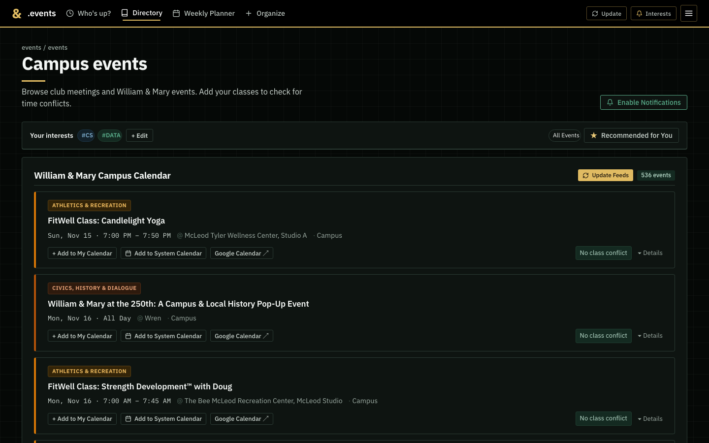
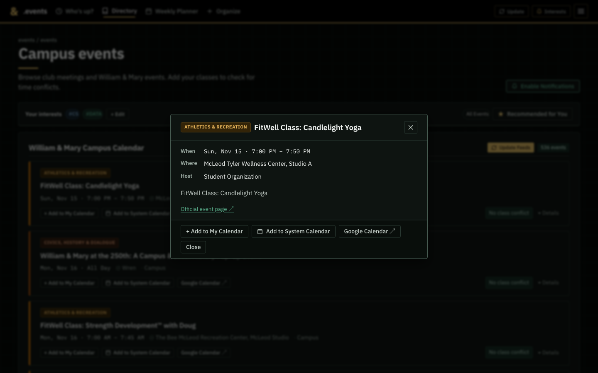
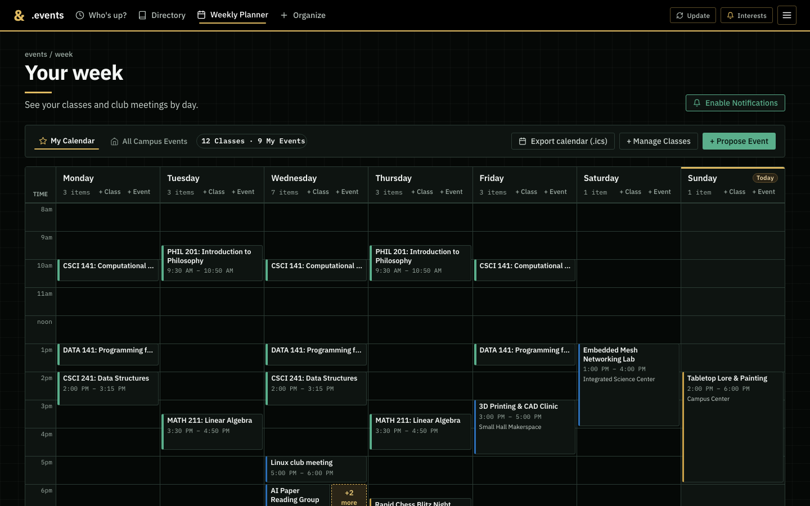
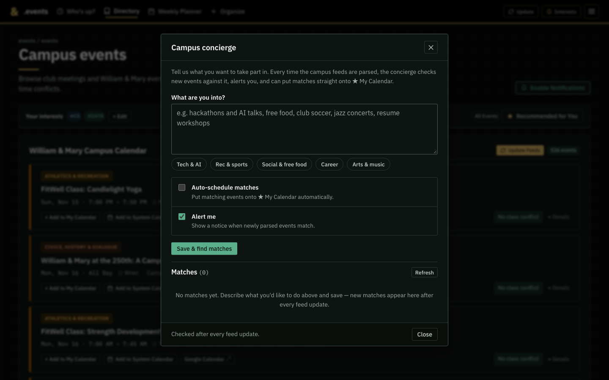
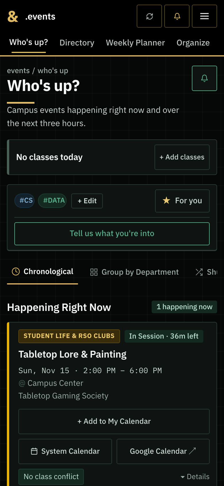
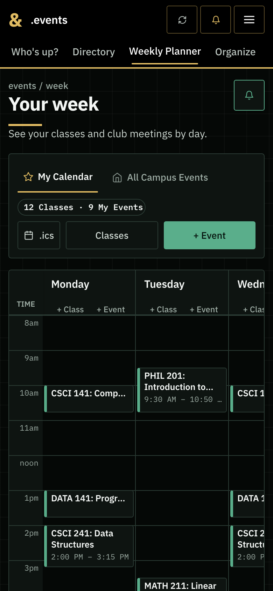

<div align="center">
  
  <h1>&amp;.events</h1>
  <p><strong>What's on at William &amp; Mary, and where it fits in your week.</strong></p>
  <p>Live campus feed · weekly planner · calendar export · interest alerts</p>

  <p>
    <a href="#what-it-does">What it does</a> •
    <a href="#screens">Screens</a> •
    <a href="#quick-start">Quick start</a> •
    <a href="#how-it-works">How it works</a> •
    <a href="#api">API</a> •
    <a href="#tests">Tests</a>
  </p>
</div>



---

## What it does

`&.events` pulls the public William & Mary calendars into one place and lays them over your class schedule, so you can see what is happening now, what is coming up, and whether it clashes with a lecture.

- **Who's up?** shows only what is in session right now and what starts in the next three hours. Multi-day exhibitions and long deadlines stay out of it.
- **Directory** lists every upcoming campus event from 15 official feeds, with duplicates across feeds merged into one card.
- **Weekly Planner** is a 7-day, time-proportional grid in the style of W&M Path. It switches between **★ My Calendar** (your classes plus events you saved) and **All Campus Events**.
- **Campus concierge** takes a plain-language description of what you like, checks every newly parsed event against it, alerts you on a match, and can add it to your calendar for you.
- **Calendar export**: every event card and modal has the same three buttons: add to the in-app calendar, download an `.ics` file, or open Google Calendar.
- **Clash detection** flags events that overlap one of your classes or double-book a room.

The project is built to merge into **[&.edu](https://github.com/alexbespik/AndEDU)** and follows its design tokens.

---

## Screens

### Live feed, light and dark

| Light | Dark |
| :---: | :---: |
|  |  |

### Directory and event details

| Directory | Event modal |
| :---: | :---: |
|  |  |

### Weekly planner



Classes and saved events are placed by start time and duration. Overlaps are grouped into a `+N more` card that opens a list, and all-day items sit in a collapsible strip so they never push the grid down.

### Campus concierge



Describe what you want ("hackathons, free food, jazz concerts"). Every feed update re-checks your interests. It works without an API key using keyword matching. If `GEMINI_API_KEY` is set, Gemini expands your interest text once when you save it, never once per event.

### Phone layout

| Who's up? | Weekly planner |
| :---: | :---: |
|  |  |

Below 640px the nav scrolls horizontally, modals become bottom sheets, the planner scrolls sideways with a sticky hour gutter, and inputs stay at 16px so iOS does not zoom.

---

## Quick start

Requires Python 3.11+.

```bash
git clone https://github.com/alexbespik/AndEVENTS.git
cd AndEVENTS
python3 -m venv .venv && source .venv/bin/activate
pip install -r requirements.txt
python3 -m uvicorn app:app --reload --port 8000
```

Open <http://127.0.0.1:8000>.

Optional: put `GEMINI_API_KEY=...` in a `.env` file next to `app.py` to let the concierge expand interest text. Nothing else needs a key.

### Pulling campus events

The app syncs itself once every 24 hours and has an **Update** button in the header. To run the importer by hand:

```bash
python3 import_wm_events.py --discover            # all default feeds
python3 import_wm_events.py --file campus=events.ics   # a local .ics file
```

Default feeds: `tribelink`, `wm-main`, `studentengagement`, `libraries`, `athletics`, `recsports`, `career`, `wellness`, `arts`, `theatre-performance`, `music`, `student-affairs`, `cce`, `computerscience`, `academiccalendarug`.

---

## How it works

```
app.py                 FastAPI app, REST API, .ics export, 24h sync loop, concierge
wm_data.py             SQLite schema, iCalendar parser, building-name normalization
import_wm_events.py    Multi-feed crawler and importer
static/index.html      Single-page UI (vanilla JS, no build step)
static/lab.css         Design tokens, light and dark themes, planner grid
tests/                 API and integration tests
ARCHITECTURE.md        Data model and API contracts in depth
```

- **No build tooling.** Plain HTML, CSS and `fetch`. No npm, no bundler.
- **Storage.** Standard-library `sqlite3` in WAL mode. Times are stored as `HH:MM` or ISO-8601 in `America/New_York` and shown in 12-hour format.
- **Tolerant parsing.** Real W&M feeds contain mismatched `DTSTART`/`DTEND` types and unfolded description lines. Non-strict import repairs these instead of dropping a whole feed.
- **Live-feed rules.** `/api/now-and-next` returns timed events in session today and events starting within 3 hours today. The client applies the same check again.
- **Typography.** `IBM Plex Sans` for all text and headings. `IBM Plex Mono` only for times, course codes and room numbers.

---

## API

| Endpoint | Purpose |
| --- | --- |
| `GET /api/now-and-next` | Events in session now and starting within 3 hours |
| `GET /api/wm-events` | Campus directory, deduplicated across feeds |
| `GET /api/events`, `POST /api/events` | Club events: list and create |
| `GET /api/classes`, `POST /api/classes/batch` | Your class schedule |
| `GET /api/planning/weekly-schedule` | Data behind the planner |
| `GET /api/calendar/export.ics` | RFC 5545 export by `event_id`, `uid`, `class_id` or `scope` |
| `GET /api/parser/status`, `POST /api/parser/run` | Sync status and manual sync |
| `GET/POST /api/ai/intent`, `GET /api/ai/alerts` | Concierge interests and matches |
| `GET /api/user-saved-events` | Events on ★ My Calendar |

Full details are in [ARCHITECTURE.md](ARCHITECTURE.md).

---

## Tests

```bash
python3 -m unittest discover tests
python3 -m unittest test_wm_data test_import_wm_events
```

---

## Contributing

`main` is protected. Push a feature branch and open a pull request. Engineering notes and the design rules live in [claude.md](claude.md).

## License

See [LICENSE](LICENSE). Part of the **[&.edu](https://github.com/alexbespik/AndEDU)** ecosystem for the College of William & Mary. Developed by [Oleksii Bespalko](https://github.com/alexbespik).
